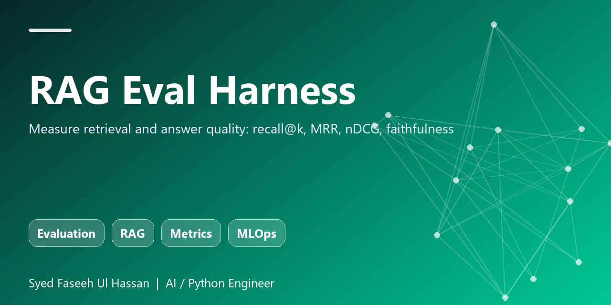

<p align="center"></p>

# RAG Eval Harness

Evaluation toolkit for RAG pipelines. Plug in any retriever and a labelled question set to get recall@k, MRR, nDCG@k, plus a cheap faithfulness (hallucination) signal.

  

## Features
- recall@k, MRR, nDCG@k
- Token-overlap faithfulness score
- `evaluate(cases, retriever)` works with any retriever
- Fully unit-tested, zero dependencies

## Quick start
```bash
git clone https://github.com/FASEEHSYED786/rag-eval-harness.git
cd rag-eval-harness
pip install -e .[dev]
pytest
```

## Usage
```python
from rag_eval import evaluate

cases = [{'question': 'leave policy?', 'relevant': ['hr.md']}]
print(evaluate(cases, my_retriever, k=3))
```

## Why this exists
Part of my applied-AI portfolio (Python, RAG, LLM agents, evaluation, LLMOps). Built to be small, readable, tested and easy to extend with a real LLM or vector store.

## Author
**Syed Faseeh Ul Hassan** - Python / AI engineer, MSc AI & Big Data - Cambridge, UK
Website: [syedfaseeh.com](https://syedfaseeh.com) - [LinkedIn](https://www.linkedin.com/in/syed-faseeh-ul-hassan-809595103/)

MIT licensed.
